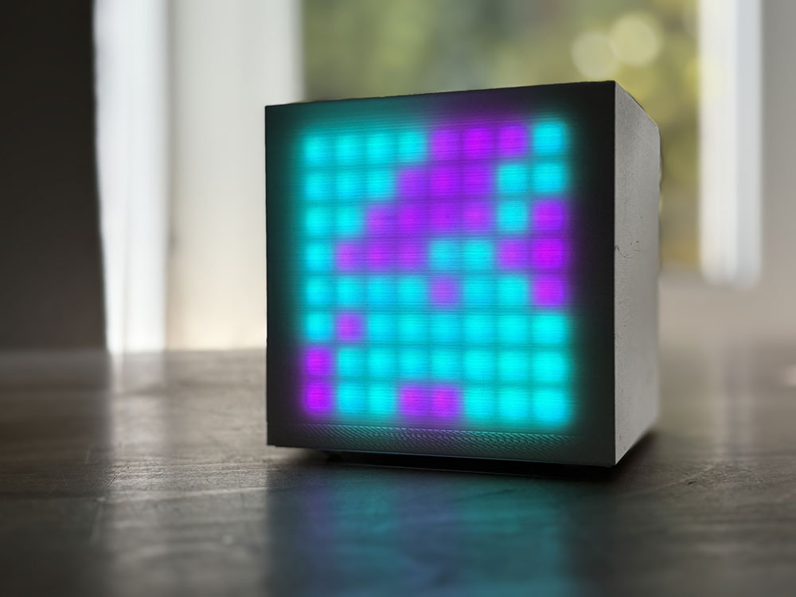

# LED matrix



A Python (Raspberry Pi) project to control an 8x8 LED matrix with various visualization modes. Display a clock, sorting algorithms, color battles, remote control via ntfy.sh, and more.

- [Hardware](#hardware)
- [Connect LED matrix to Pi](#connect-led-matrix-to-pi)
- [Install](#install)
- [Modes](#modes)
- [Change mode](#change-mode)
- [Change brightness](#change-brightness)
- [Switch between modes](#switch-modes)
- [Change at set times](#set-times)
- [Mode settings](#mode-settings)
- [Display orientation](#display)
- [Create a mode](#create-a-mode)
- [Update](#update)

<a id="hardware"></a>
## Hardware

- Raspberry Pi; I use a Pi Zero WH but any Pi will probably do just fine (other models might not fit in the case)
- LED matrix; WS2812B-64 (8x8 RGB LED matrix)
- Power supply for the Pi
- Optional: 3D printed case; see [case](https://github.com/rickvanderwolk/led-matrix/tree/main/case)

<a id="connect-led-matrix-to-pi"></a>
## Connect LED matrix to Pi

| WS2812B Matrix Pin | Function   | Connect to Raspberry Pi Pin | Raspberry Pi GPIO |
| ------------------ | ---------- | --------------------------- | ----------------- |
| **V+**             | Power (5V) | Pin **2**                   | 5V                |
| **V-**             | Ground     | Pin **6**                   | GND               |
| **IN**             | Data In    | Pin **12**                  | **GPIO18**        |

<a id="install"></a>
## Install

1. Install Raspberry Pi OS on a SD card. You can easily choose the right image and setup a username / password, Wi-Fi and enable SSH with the [Raspberry Pi OS imager](https://www.raspberrypi.com/software/). I've used the latest recommended image `Raspberry Pi OS Lite (32-bit) - Release date 2025-05-13 - A port of Debian Bookworm with no desktop environment` in the example below, but I recommend just installing the latest recommended version.
2. Boot the Pi (might take a while depending on which Pi you're using)
3. Connect via SSH `ssh <username>@<your-pi-host-or-ip>`
4. Install git `sudo apt install -y git`
5. Clone repository `git clone https://github.com/rickvanderwolk/led-matrix.git`
6. Run install script `bash led-matrix/install.sh` (might take a while)

You're all set, the LED matrix will start automatically.

<a id="modes"></a>
## Modes

- [clock](https://github.com/rickvanderwolk/led-matrix/tree/main/modes/clock) - 4-quadrant clock with Pomodoro timer
- [collision](https://github.com/rickvanderwolk/led-matrix/tree/main/modes/collision) - Colorful particle collisions with mixed color explosions
- [evolving-square](https://github.com/rickvanderwolk/led-matrix/tree/main/modes/evolving-square) - Randomly evolving colored pixels
- [led-sort](https://github.com/rickvanderwolk/led-matrix/tree/main/modes/led-sort) - Visualize sorting algorithms
- [ntfy-sh](https://github.com/rickvanderwolk/led-matrix/tree/main/modes/ntfy-sh) - Remote control via ntfy.sh
- [pathfinder](https://github.com/rickvanderwolk/led-matrix/tree/main/modes/pathfinder) - Pathfinding algorithm visualization
- [pixels-fighting](https://github.com/rickvanderwolk/led-matrix/tree/main/modes/pixels-fighting) - Color battle simulation

<a id="change-mode"></a>
## Change mode

Change `mode` in `config.json`. For example: `{"mode": "evolving-square"}` (use the directory name of the mode in the `modes` directory).

Changes to `config.json` are picked up automatically within a few seconds, no restart needed. Modes fade out and in when switching.

<a id="change-brightness"></a>
## Change brightness

Change `brightness` in `config.json`. For example: `{"brightness": 0.25}` (use 0 to 1, 0 is off).

Brightness changes fade in smoothly, without restarting the running mode.

<a id="switch-modes"></a>
## Switch between modes

Instead of a single mode, `mode` can be a list of modes that take turns:

```json
{
  "mode": ["collision", "pathfinder", "pixels-fighting", "led-sort"],
  "switch_every": "15m",
  "shuffle": true
}
```

Use `"all"` to switch between all modes, also ones added later. Leave modes out with `skip_modes`:

```json
{
  "mode": "all",
  "skip_modes": ["clock"],
  "switch_every": "15m"
}
```

Modes that need a setting to show anything (like the ntfy.sh topic) are left out of `"all"` until that setting is there; the log says so.

`switch_every` is in seconds (`"30s"`, handy to quickly try all modes), minutes (`"15m"`) or hours (`"2h"`), 1 hour by default, and lines up with the clock: `"1h"` switches on the hour. With `shuffle` every mode plays once per round, in a random order. The mode only depends on the time, so after a restart the same mode keeps playing.

<a id="set-times"></a>
## Change at set times

`mode`, `skip_modes`, `brightness`, `switch_every` and `shuffle` can also be set per time. Each value applies from its time until the next one, wrapping around midnight. For example, switch between modes all day, dim in the evening and switch off at night:

```json
{
  "mode": ["collision", "pathfinder", "pixels-fighting", "led-sort"],
  "switch_every": "15m",
  "brightness": { "07:00": 0.2, "21:30": 0.05, "23:00": 0 }
}
```

Or show the clock during the day and switch between all modes in the evening:

```json
{
  "mode": { "07:00": "clock", "18:00": "all" },
  "brightness": { "07:00": 0.2, "23:00": 0 }
}
```

Every setting has its own times, so the brightness changes regardless of which mode is playing. Brightness changes fade without restarting the mode.

This uses the Pi's system time, so make sure the time zone is set (`sudo raspi-config` > Localisation Options > Timezone).

<a id="mode-settings"></a>
## Mode settings

Some modes have settings. They go in `mode_settings`, under the name of the mode, and apply whenever that mode runs:

```json
{
  "mode": "ntfy-sh",
  "mode_settings": {
    "ntfy-sh": { "topic": "90ad44f3b530" },
    "pixels-fighting": { "speed": 150 }
  }
}
```

See the README of each mode for its settings.

<a id="display"></a>
## Display orientation

If the matrix is mounted rotated or mirrored:

```json
{
  "display": { "rotate": 90, "flip_x": false, "flip_y": false }
}
```

`rotate` is clockwise: 0, 90, 180 or 270.

<a id="create-a-mode"></a>
## Create a mode

A mode is a directory in `modes/` with a `main.py` (any name except `all`). The `core` package takes care of the hardware, config, brightness, set times, orientation and switching the LEDs off on exit, so a mode only has to draw:

```python
from core import Matrix, hsv

matrix = Matrix()

for frame in matrix.frames(fps=30):
    matrix.clear()
    matrix[frame % 8, 3] = hsv(frame / 64)
```

- `matrix[x, y] = (r, g, b)` or `matrix[index]` (row by row, 0 is top left). Writes outside the matrix are ignored, reads return `None`.
- `matrix.fill(color)`, `matrix.clear()`, `matrix.neighbors(x, y)`, `matrix.width`, `matrix.height`, `matrix.count`
- `matrix.frames(fps)` loops at a steady frame rate and shows each frame. For modes that don't fit a frame loop, call `matrix.show()` yourself (unchanged frames are skipped, so calling it often is cheap).
- `matrix.settings` holds this mode's settings from `config.json` (`"mode_settings": {"<mode-name>": {...}}`). Changing them restarts the mode, so a mode can read them once at the start.
- Color helpers: `hsv(h, s, v)`, `mix(color1, color2, t)`, `scale(color, factor)`, `BLACK`, `WHITE`.

Try it without hardware using the [visualizer](https://github.com/rickvanderwolk/led-matrix/tree/main/visualizer).

<a id="update"></a>
## Update

Update to latest version. 

`cd ~/led-matrix && git pull && bash install.sh`
